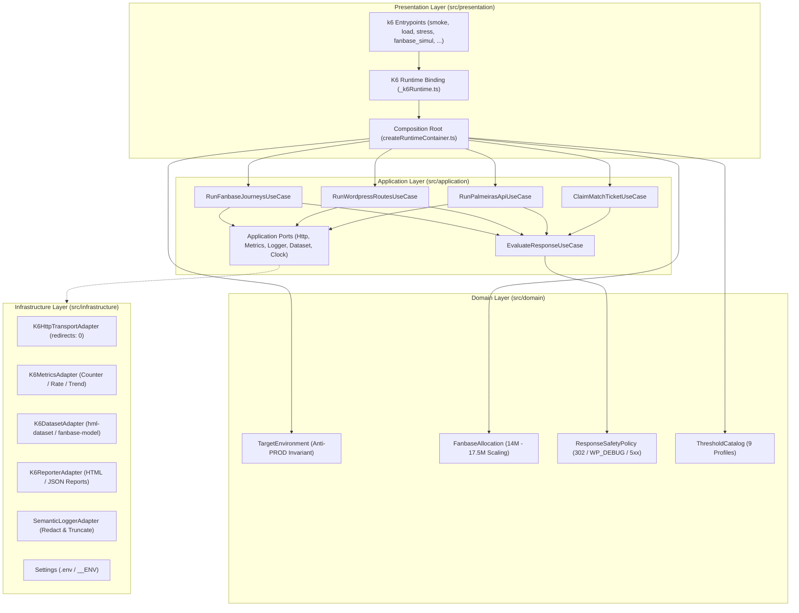

# Palmeiras K6 Test (HML)

[](https://k6.io/)
[](tsconfig.json)
[](vitest.config.ts)
[](eslint.config.mjs)
[](vitest.config.ts)
[](linters/README.md)
[](docs/arquitetura.md)
[](.agents/rules/hml-safety.md)

Suíte autônoma de testes de carga, estresse, resiliência e validação funcional projetada exclusivamente para o ambiente de **Homologação (HML)** da infraestrutura AWS e aplicação WordPress da Sociedade Esportiva Palmeiras. Opera com execução nativa de cenários TypeScript no **Grafana k6 v2.3.0**, invariantes determinísticas anti-PROD, simulação simultânea multi-persona da torcida, observabilidade semântica estruturada e Matriz de Qualidade Unificada de 5 estágios com meta inegociável de 100% de cobertura de código (`branch coverage`).

## Visão Geral da Arquitetura

O sistema é construído sobre os pilares de **Domain-Driven Design (DDD)** e **Arquitetura Hexagonal (Ports & Adapters)**, garantindo desacoplamento total entre as regras de segurança HML, cálculos de dimensionamento da torcida e políticas de resposta em relação ao runtime `k6`:



## Características Principais

- **Invariante Estrutural Anti-PROD**: Remoção definitiva de `prod_alb` e bloqueio *fail-fast* (`ForbiddenProductionTargetError`) contra qualquer referência a produção (`prod`, `www.palmeiras.com.br`, `1627138501`) no `TargetEnvironment`, combinados com `redirects: 0` obrigatório no `K6HttpTransportAdapter` para impedir redirecionamento automático da função `log_homolog_v2()`.
- **Simulação Simultânea da Torcida (`fanbase_simul.ts`)**: Modela a torcida estimada entre 14 milhões e 17,5 milhões de torcedores (6,5% a 8,1% da preferência nacional) com 6 personas disparando simultaneamente (`startTime: '0s'`) escaladas via `SCALE_FACTOR` para respeitar o limite da EC2 `homolog` (`t3a.medium`, `php8.3-fpm pm.max_children=35`).
- **Sanitização de Payloads `WP_DEBUG_DISPLAY`**: `ResponseSafetyPolicy` contabiliza e remove prefixos HTML de `Warning`, `Notice` e `Deprecated` emitidos em HML antes do `JSON.parse`, permitindo validação real dos payloads REST.
- **Matriz Completa de Métodos e Respostas HML**: Validação contínua de `GET`, `HEAD`, `OPTIONS` e `POST` cobrindo códigos `200`, `301`, `302`, `400`, `401` (`/wp-json/toApp/v1/*`), `403` (`/xmlrpc.php`, `wp-config.php.bak`), `404` e regressões `500` monitoradas (`/wp-json/palmeiras/v1/atendimento` e `/wp-json/apiverdao/v1/jogos-atualizar`).
- **Cobertura Contínua 100% Branch Coverage**: Núcleo de domínio, casos de uso, adaptadores de infraestrutura e Composition Root validados por testes unitários e de integração em Vitest antes da execução em HML.

## Instalação e Configuração

### Pré-requisitos

- Node.js 20 ou superior e npm
- Python 3.13 ou superior
- Grafana `k6` v2.3.0 ou superior
- Docker com Buildx (para validação de contêiner) e AWS CLI (opcional, para scripts de recon e CloudWatch em HML)

### Inicialização do Ambiente

```bash
cp .env.example .env
make app-setup
```

Ajuste as variáveis no arquivo `.env` local ou via `-e CHAVE=VALOR` na chamada do `k6`:

| Variável | Descrição | Padrão |
| :--- | :--- | :--- |
| `SMOKE_PROFILE` | Perfil do smoke (`functional` ou `strict`) | `functional` |
| `TARGET_ENV` | Alvo de HML, resolvido pelo controlador | `azion_edge` |
| `SCALE_FACTOR` | Fator de escala dos VUs simultâneos no cenário `fanbase_simul.ts` | `1` |
| `RAMP_UP` | Duração da rampa de subida no `fanbase_simul.ts` | `20s` |
| `HOLD` | Duração de sustentação no `fanbase_simul.ts` | `40s` |
| `RAMP_DOWN` | Duração de desaceleração no `fanbase_simul.ts` | `15s` |
| `SOAK_VUS` | Quantidade fixa de VUs no teste de resistência `soak.ts` | `8` |
| `SOAK_DURATION` | Duração total do cenário `soak.ts` | `10m` |
| `LOG_LEVEL` | Nível mínimo de log estruturado (`DEBUG`, `INFO`, `WARN`, `ERROR`) | `INFO` |
| `LOG_ERRORS` | Habilita registro estruturado de falhas HTTP e anomalias HML | `true` |
| `LOG_ERROR_SAMPLE_RATE` | Taxa de amostragem (`0` a `1`) para logs de erro sob alta concorrência | `1` |
| `SCENARIO_NAME` | Identificador auxiliar de cenário para nomeação de relatórios | `smoke` |

## Comandos Operacionais

Todas as tarefas de validação, execução em HML e contêineres são expostas via `Makefile` (`make help`), organizadas em 4 categorias canônicas:

```bash
# 1. APP e Quality Gate (5 Estágios)
make help                                # Exibe menu completo e toolchain detectada
make app-setup                           # Prepara .env, dependências e hooks (alias: app-start)
make app-ci                              # Executa o pipeline completo dos 5 estágios com tabela de resumo
make app-gate STAGE=all                  # Executa estágio: lint, security, test, validate, build ou all
make app-hooks                           # Executa pre-commit em todos os arquivos
make app-clean                           # Remove caches dist/, coverage/ e __pycache__

# 2. Testes de HML (Proibido PROD)
make test-smoke                          # Smoke funcional padrão (TARGET=azion, alb, ec2 ou all)
make test-smoke TARGET=alb               # Validação direta no ALB teste-multi-proxy (recomendado)
make test-smoke TARGET=ec2               # Validação direta na EC2 do ASG via túnel SSM
make test-smoke TARGET=alb SMOKE_PROFILE=strict  # Smoke curto com SLAs rígidos
make test-fanbase TARGET=alb ALLOW_FANBASE_LOAD=true SCALE_FACTOR=0.4 RAMP_UP=5s HOLD=15s RAMP_DOWN=5s
make test-504 MODE=compare               # Diagnóstico comparativo nos 3 caminhos (EC2, ALB, Azion)
make test-504 MODE=session TARGET=alb    # Diagnóstico de lock de sessão
make test-504 MODE=sync TARGET=alb HEAVY_PATH=/wp-admin/
make test-run SCENARIO=api_mix TARGET=alb

# 3. Observabilidade e Telemetria
make obs-recon                           # Descoberta de ALB, ASG e recursos atuais de HML
make obs-collect CW_MINUTES=15           # Coleta métricas e logs AWS/SSM da janela recente
make obs-collect RUN=reports/runs/<ID>.json # Coleta focada na janela de uma rodada
make obs-watch WATCH_INTERVAL=15         # Acompanha ALB e hosts do ASG continuamente
make obs-diagnose RUN=reports/runs/<ID>.json AZION_LOG=logs.json # Correlaciona k6, ALB e Azion

# 4. Execução Conteinerizada (Docker)
make docker-build                        # Constrói a imagem da suíte
make docker-test TEST=smoke TARGET=alb   # Executa TEST=smoke, fanbase ou 504 no TARGET
make docker-up                           # Inicializa serviço palmeiras-k6 em segundo plano
make docker-logs                         # Acompanha logs em tempo real (LEVEL=all / F=0 / T=1 / P=1)
make docker-ps                           # Exibe o estado dos contêineres
make docker-sh                           # Abre shell no contêiner da suíte
make docker-down                         # Encerra o serviço preservando reports/
make docker-clean                        # Remove contêineres, redes e imagem local
```

## Integração Contínua e Harness de Agentes

- **Matriz CI/CD**: Matriz de 4 áreas temáticas (`TypeScript/k6`, `Docker`, `GitHub`, `Scripts`) e 5 estágios determinísticos (`Lint`, `Security`, `Test`, `Validate`, `Build`) documentada em [docs/devops.md](docs/devops.md).
- **Harness Universal de Agentes**: Regras de conduta, segurança HML e skills operacionais em [.agents/](.agents/README.md) e [AGENTS.md](AGENTS.md).
- **Documentação Técnica Completa**: Disponível no diretório [docs/](docs/README.md).


## Operação atual de HML

Use `make test-smoke TARGET=azion`, `TARGET=alb`, `TARGET=ec2` ou
`TARGET=all`. A topologia atual é descoberta na AWS antes de cada rodada.
O controlador produz um manifesto em `reports/runs/` para correlação com
`make obs-diagnose RUN=...`.

`make obs-collect` e `make obs-watch` consultam o ALB e os membros atuais
do ASG. Traces são informados como indisponíveis enquanto não houver APM
confirmado. Os detalhes de execução e o formato de logs da Azion estão em
[Reconhecimento de HML](docs/recon-hml.md).
