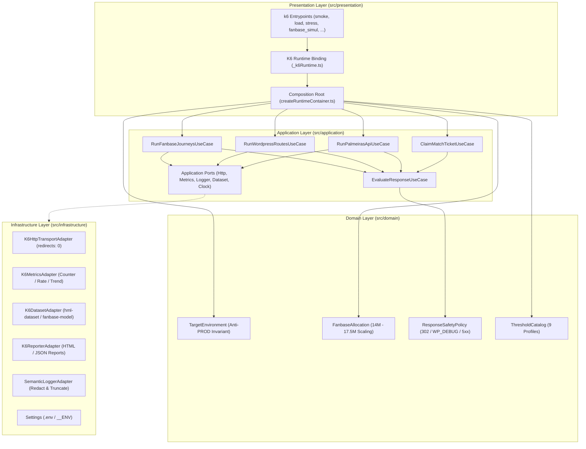

# Palmeiras K6 Test (HML)

[](https://k6.io/)
[](tsconfig.json)
[](vitest.config.ts)
[](eslint.config.mjs)
[](vitest.config.ts)
[](linters/README.md)
[](docs/arquitetura.md)
[](.agents/rules/hml-safety.md)

Suíte autônoma de testes de carga, estresse, resiliência e validação funcional projetada exclusivamente para o ambiente de **Homologação (HML)** da infraestrutura AWS e aplicação WordPress da Sociedade Esportiva Palmeiras. Opera com execução nativa de cenários TypeScript no **Grafana k6 v2.3.0**, invariantes determinísticas anti-PROD, simulação simultânea multi-persona da torcida, observabilidade semântica estruturada e Matriz de Qualidade Unificada de 5 estágios com meta inegociável de 100% de cobertura de código (`branch coverage`).

## Visão Geral da Arquitetura

O sistema é construído sobre os pilares de **Domain-Driven Design (DDD)** e **Arquitetura Hexagonal (Ports & Adapters)**, garantindo desacoplamento total entre as regras de segurança HML, cálculos de dimensionamento da torcida e políticas de resposta em relação ao runtime `k6`:



## Características Principais

- **Invariante Estrutural Anti-PROD**: Remoção definitiva de `prod_alb` e bloqueio *fail-fast* (`ForbiddenProductionTargetError`) contra qualquer referência a produção (`prod`, `www.palmeiras.com.br`, `1627138501`) no `TargetEnvironment`, combinados com `redirects: 0` obrigatório no `K6HttpTransportAdapter` para impedir redirecionamento automático da função `log_homolog_v2()`.
- **Simulação Simultânea da Torcida (`fanbase_simul.ts`)**: Modela a torcida estimada entre 14 milhões e 17,5 milhões de torcedores (6,5% a 8,1% da preferência nacional) com 6 personas disparando simultaneamente (`startTime: '0s'`) escaladas via `SCALE_FACTOR` para respeitar o limite da EC2 `homolog` (`t3a.medium`, `php8.3-fpm pm.max_children=35`).
- **Sanitização de Payloads `WP_DEBUG_DISPLAY`**: `ResponseSafetyPolicy` contabiliza e remove prefixos HTML de `Warning`, `Notice` e `Deprecated` emitidos em HML antes do `JSON.parse`, permitindo validação real dos payloads REST.
- **Matriz Completa de Métodos e Respostas HML**: Validação contínua de `GET`, `HEAD`, `OPTIONS` e `POST` cobrindo códigos `200`, `301`, `302`, `400`, `401` (`/wp-json/toApp/v1/*`), `403` (`/xmlrpc.php`, `wp-config.php.bak`), `404` e regressões `500` monitoradas (`/wp-json/palmeiras/v1/atendimento` e `/wp-json/apiverdao/v1/jogos-atualizar`).
- **Cobertura Contínua 100% Branch Coverage**: Núcleo de domínio, casos de uso, adaptadores de infraestrutura e Composition Root validados por testes unitários e de integração em Vitest antes da execução em HML.

## Instalação e Configuração

### Pré-requisitos

- Node.js 20 ou superior e npm
- Python 3.13 ou superior
- Grafana `k6` v2.3.0 ou superior
- Docker com Buildx (para validação de contêiner) e AWS CLI (opcional, para scripts de recon e CloudWatch em HML)

### Inicialização do Ambiente

```bash
cp .env.example .env
make app-setup
```

Ajuste as variáveis no arquivo `.env` local ou via `-e CHAVE=VALOR` na chamada do `k6`:

| Variável | Descrição | Padrão |
| :--- | :--- | :--- |
| `TARGET_ENV` | Alvo HML permitido (`hml_classic_elb`, `hml_alb`, `azion_edge`) | `hml_classic_elb` |
| `SCALE_FACTOR` | Fator de escala dos VUs simultâneos no cenário `fanbase_simul.ts` | `1` |
| `RAMP_UP` | Duração da rampa de subida no `fanbase_simul.ts` | `20s` |
| `HOLD` | Duração de sustentação no `fanbase_simul.ts` | `40s` |
| `RAMP_DOWN` | Duração de desaceleração no `fanbase_simul.ts` | `15s` |
| `SOAK_VUS` | Quantidade fixa de VUs no teste de resistência `soak.ts` | `8` |
| `SOAK_DURATION` | Duração total do cenário `soak.ts` | `10m` |
| `LOG_LEVEL` | Nível mínimo de log estruturado (`DEBUG`, `INFO`, `WARN`, `ERROR`) | `INFO` |
| `LOG_ERRORS` | Habilita registro estruturado de falhas HTTP e anomalias HML | `true` |
| `LOG_ERROR_SAMPLE_RATE` | Taxa de amostragem (`0` a `1`) para logs de erro sob alta concorrência | `1` |
| `SCENARIO_NAME` | Identificador auxiliar de cenário para nomeação de relatórios | `smoke` |

## Comandos Operacionais

Todas as tarefas de validação, execução em HML e contêineres são expostas via `Makefile` (`make help`):

```bash
# Menu interativo e Quality Gates (5 Estágios)
make help               # Exibe menu completo e toolchain detectada
make app-lint           # TypeScript strict, ESLint, zero comentários, <= 300 linhas, zero emojis
make app-security       # Varredura de segredos, auditoria anti-PROD e npm audit --omit=dev
make app-test           # Vitest com 100% branch coverage + k6 inspect em todos os cenários
make app-validate       # Validação de JSONs, Docker/CI YAML, links Markdown e bash -n
make app-build          # Compilação tsc e docker build --check
make app-ci             # Executa o pipeline completo dos 5 estágios com tabela de resumo
make app-clean          # Remove dist/, coverage/ e __pycache__

# Operações em HML (Proibido PROD)
make hml-azion-smoke    # Verifica o WordPress de HML pela Azion
make hml-azion-fanbase ALLOW_FANBASE_LOAD=true SCALE_FACTOR=0.4 RAMP_UP=5s HOLD=15s RAMP_DOWN=5s
make hml-cw-multi-proxy CW_MINUTES=15  # Consulta métricas do ALB teste-multi-proxy

# Execução Conteinerizada (Docker Compose)
make docker-up          # Inicializa serviço palmeiras-k6 em segundo plano
make docker-smoke       # Executa smoke.ts em HML dentro do contêiner (--rm)
make docker-fanbase     # Executa fanbase_simul.ts preservando relatórios em reports/
make docker-logs        # Acompanha logs em tempo real (LEVEL=all / F=0 / T=1 / P=1)
make docker-down        # Para o contêiner preservando reports/
```

## Integração Contínua e Harness de Agentes

- **Matriz CI/CD**: Matriz de 4 áreas temáticas (`TypeScript/k6`, `Docker`, `GitHub`, `Scripts`) e 5 estágios determinísticos (`Lint`, `Security`, `Test`, `Validate`, `Build`) documentada em [docs/devops.md](docs/devops.md).
- **Harness Universal de Agentes**: Regras de conduta, segurança HML e skills operacionais em [.agents/](.agents/README.md) e [AGENTS.md](AGENTS.md).
- **Documentação Técnica Completa**: Disponível no diretório [docs/](docs/README.md).
