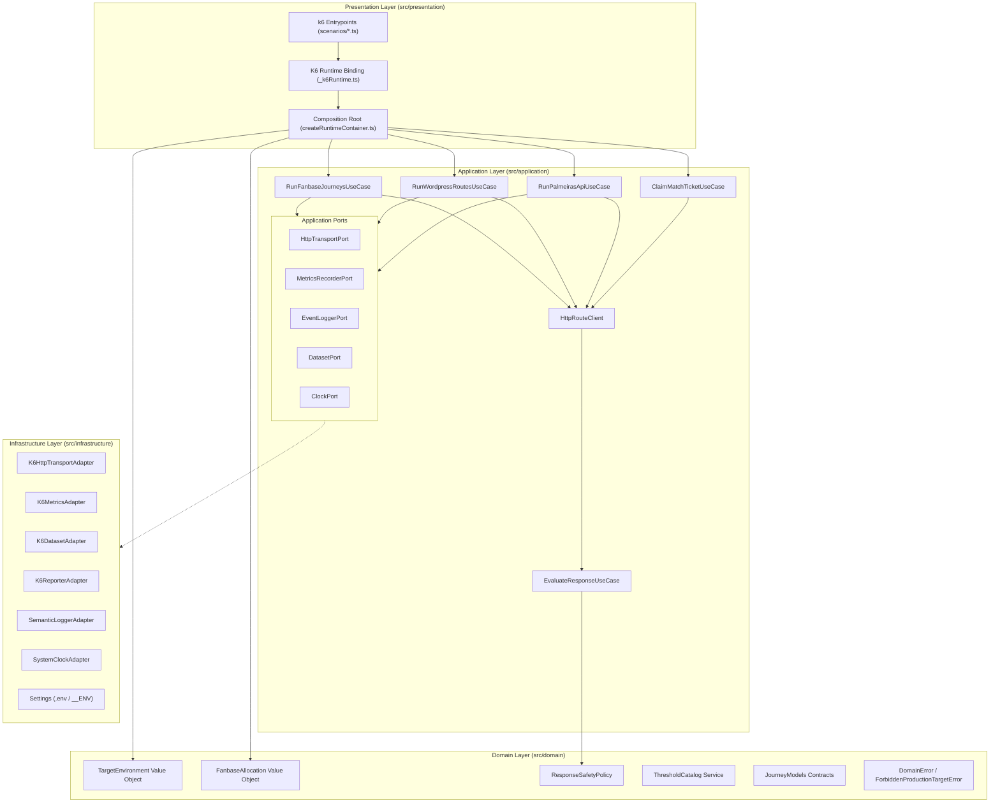

# Arquitetura do Palmeiras K6 Test (HML)

Este documento especifica a arquitetura técnica, as fronteiras de domínio e as políticas de negócio adotadas no **Palmeiras K6 Test (HML)**.

## 1. Visão Geral e Paradigma Arquitetural

O sistema é estruturado em conformidade com os princípios de **Domain-Driven Design (DDD)** e **Arquitetura Hexagonal (Ports & Adapters)**. As invariantes anti-PROD, os cálculos de distribuição simultânea da torcida e as regras de inspeção de resposta HTTP permanecem estritamente isolados do motor Goja do `k6`, das chamadas de rede e da serialização de relatórios.

## 2. Divisão e Responsabilidade das Camadas

### 2.1 Camada de Domínio (`src/domain`)

O núcleo puro do sistema, sem importações de `k6`, `node:*` ou bibliotecas externas.

- `errors/DomainError.ts`: Exceções `DomainInvariantError` e `ForbiddenProductionTargetError`.
- `entities/JourneyModels.ts`: Contratos canônicos imutáveis (`HmlDataset`, `FanbaseModel`, `WpPostDetailPayload`, `SearchHitPayload`, `JogosMesPayload`, `SafetyEvaluationResult`, `ScenarioName`).
- `value_objects/TargetEnvironment.ts`: Value Object que valida e resolve apenas os 3 alvos HML autorizados (`hml_classic_elb`, `hml_alb`, `azion_edge`), aplicando `assertNotProd`.
- `value_objects/FanbaseAllocation.ts`: Dimensiona de forma determinística as 6 personas simultâneas da torcida entre 14 milhões e 17,5 milhões de torcedores conforme `scaleFactor`.
- `policies/ResponseSafetyPolicy.ts`: Regras puras para leitura de cabeçalhos case-insensitive, detecção de redirects para PROD, identificação de sinais de cache (`X-FastCGI-Cache`, `X-Cache`, `Age`), extração limpa de JSON após vazamentos de `WP_DEBUG_DISPLAY` e detecção de erros fatais/deadlocks.
- `services/ThresholdCatalog.ts`: Catálogo estrito de SLAs dos 9 perfis de cenário mantendo sempre `checks{check:no_prod_redirect}: ['rate==1']`.

*Invariante*: O domínio nunca emite chamadas de log e desconhece detalhes de transporte HTTP ou métricas do `k6`.

### 2.2 Camada de Aplicação (`src/application`)

Coordena os fluxos de requisição, jornadas encadeadas e avaliação de respostas por meio de contratos abstratos.

- `ports/HttpTransportPort.ts`: Contrato `request(req: TransportRequest): TransportResponse`.
- `ports/MetricsRecorderPort.ts`: Contrato de registro de métricas (`recordCacheHit`, durações, contadores de anomalia e `recordChecks`).
- `ports/EventLoggerPort.ts`: Contrato de emissão semântica (`emit(level, event, fields)`).
- `ports/DatasetPort.ts`: Contrato de acesso aos arquivos `HmlDataset` e `FanbaseModel`.
- `ports/ClockPort.ts`: Abstração determinística de tempo (`nowMs()`) e entropia (`random()`).
- `use_cases/ResolveEnvironmentUseCase.ts`: Resolve `TargetEnvironment` com fail-fast anti-PROD.
- `use_cases/EvaluateResponseUseCase.ts`: Aplica `ResponseSafetyPolicy`, atualiza contadores de segurança e registra eventos apenas quando há anomalias ou warnings extraídos.
- `use_cases/HttpRouteClient.ts`: Monta `TransportRequest` com cabeçalhos padrão HML, executa via `HttpTransportPort`, contabiliza latência e invoca avaliação de segurança.
- `use_cases/RunWordpressRoutesUseCase.ts`: Rotas base do WordPress (`/check.html`, `/`, `/?s=...`, `/wp-json/wp/v2/search`, `/wp-json/wp/v2/posts`, `/wp-json/wp/v2/pages`, `/wp-admin/admin-ajax.php`).
- `use_cases/RunPalmeirasApiUseCase.ts`: Endpoints customizados `apiverdao/v1/*`, `palmeiras/v1/*`, `wp/v2/campeonato`, guarda de autenticação `/wp-json/toApp/v1/*` (`401`) e sondas de regressão `500` conhecidas (`atendimento`, `jogos-atualizar`).
- `use_cases/RunFanbaseJourneysUseCase.ts`: Jornadas encadeadas multi-passo de leitura de notícias, dia de jogo, busca com resolução dinâmica de `_links.self` protegida por `assertNotProd`, catálogo/mídia e matriz completa de métodos e status HTTP.
- `use_cases/ClaimMatchTicketUseCase.ts`: Contenção de concorrência para a rota transacional legada `/api/v1/ingressos/claim`.

### 2.3 Camada de Infraestrutura (`src/infrastructure`)

Implementa as portas da aplicação para runtime `k6`, configuração e telemetria.

- `config/Settings.ts`: Leitura e validação estrita de variáveis de ambiente (`TARGET_ENV`, `SCALE_FACTOR`, `RAMP_UP`, `HOLD`, `RAMP_DOWN`, `SOAK_VUS`, `SOAK_DURATION`, `LOG_LEVEL`, `LOG_ERRORS`, `LOG_ERROR_SAMPLE_RATE`, `SCENARIO_NAME`).
- `logging/SemanticLoggerAdapter.ts`: Emissão de eventos estruturados JSON via `logEvent` com redação automática de dados sensíveis e truncamento de payloads.
- `k6/K6HttpTransportAdapter.ts`: Ponte para `k6/http` impondo `redirects: 0` e mapeamento de `http.expectedStatuses`.
- `k6/K6MetricsAdapter.ts`: Ponte para `Counter`, `Rate`, `Trend` e `check` nativos do `k6`.
- `k6/K6DatasetAdapter.ts`: Fornecimento dos payloads reais de HML carregados via `SharedArray`.
- `k6/K6ReporterAdapter.ts`: Geração automática dos resumos HTML e JSON em `reports/`.
- `repositories/SystemClockAdapter.ts`: Implementação concreta de `ClockPort`.

### 2.4 Camada de Apresentação (`src/presentation`)

Composition Root e entrypoints declarativos executados pelo binário `k6`.

- `composition/createRuntimeContainer.ts`: Único ponto de injeção `Settings -> Adapters -> Use Cases`, retornando `RuntimeContainer`.
- `scenarios/_k6Runtime.ts`: Instancia métricas `k6/metrics`, carrega `SharedArray` e constrói o `RuntimeContainer`.
- `scenarios/*.ts`: Perfis `smoke`, `load`, `stress`, `spike`, `soak`, `api_mix`, `cache_bypass`, `race_conditions` e `fanbase_simul`.

## 3. Políticas de Negócio Detalhadas

### 3.1 Invariante Anti-PROD e Proteção contra `log_homolog_v2()`

Durante o recon da aplicação em HML (`functions.php:4920`), constatou-se que requisições HTML não autenticadas enviadas com `Host: hmlverdao.palmeiras.com.br` recebem `302 Found` apontando para `https://www.palmeiras.com.br<uri>`:

1. **Bloqueio de Entrada**: `TargetEnvironment.fromName` rejeita qualquer configuração contendo `/prod/i`, `www.palmeiras.com.br` ou `1627138501` antes do primeiro socket ser aberto.
2. **Bloqueio de Redirecionamento**: `K6HttpTransportAdapter` fixa `redirects: 0` em todas as chamadas HTTP, impedindo o motor Goja de seguir `302` rumo à produção.
3. **Verificação por Check Obrigatório**: Toda requisição é avaliada por `ResponseSafetyPolicy`; desvios que apontem para PROD fora de rotas HTML conhecidamente monitoradas (`homepage`, `search_html`, `claim_ticket`) falham o check `no_prod_redirect` (`rate==1`).

### 3.2 Dimensionamento Simultâneo da Torcida (`FanbaseAllocation`)

Para simular a torcida palmeirense (14 milhões a 17,5 milhões de torcedores, 6,5% a 8,1% do Brasil) sem derrubar ou mascarar o ambiente HML (`t3a.medium`, 2 vCPUs, 3.863 MB de RAM, `php8.3-fpm pm.max_children=35` e porta `84` sem `fastcgi_cache`), todas as personas iniciam juntas em `startTime: '0s'`:

| Persona Simultânea | Fluxo Executado | VUs Base (`SCALE_FACTOR=1`) | Participação Relativa |
| :--- | :--- | :---: | :---: |
| `fanbase_news_readers` | Lista de posts -> Post -> Categoria -> Mídia | 12 | 34,3% |
| `fanbase_matchday_live` | Jogos do mês -> Classificação -> Estatísticas -> Campeonatos -> Ao Vivo | 8 | 22,9% |
| `fanbase_searchers` | Busca `/wp/v2/search` -> Abertura dinâmica via `_links.self` | 5 | 14,3% |
| `fanbase_catalog_media` | Eventos do mês, lojas SEP, galeria de fotos e vídeos | 4 | 11,4% |
| `fanbase_mobile_app` | Endpoints autenticados `/wp-json/toApp/v1/*` (`401`) | 3 | 8,6% |
| `fanbase_protocol_matrix` | Matriz `HEAD`/`OPTIONS`/`GET`/`POST` e status `200` a `500` | 3 | 8,6% |

### 3.3 Tratamento de `WP_DEBUG_DISPLAY` e Regressões Monitoradas

Em HML, o tema e plugins emitem alertas HTML (`<b>Warning</b>`, `<b>Notice</b>`, `<b>Deprecated</b>`) antes do corpo JSON:
- `extractPhpWarningFreeJson` contabiliza o vazamento via métrica `php_warning_leak_detected`, isola o início real de `{` ou `[` e processa integralmente os registros (`json_records_processed`).
- Os endpoints `/wp-json/palmeiras/v1/atendimento` e `/wp-json/apiverdao/v1/jogos-atualizar` são monitorados com `expectedStatuses(200, 500)` e contabilizados em `known_hml_500_endpoints` sem contaminar a métrica `http_req_failed`.
