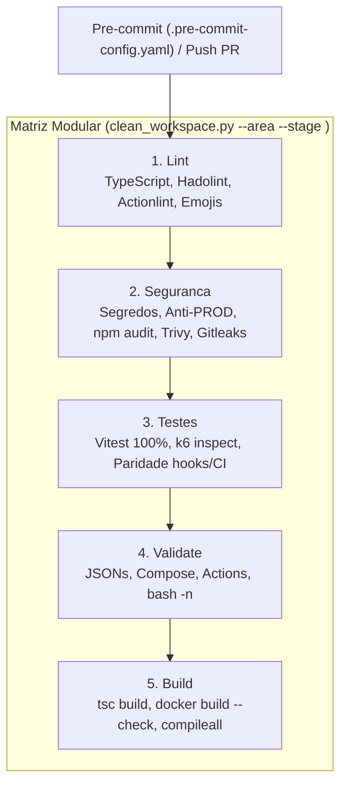

# DevOps, CI/CD e Automação Contínua

Especificação formal da esteira de qualidade local, git hooks e Integração Contínua (CI) do **Palmeiras K6 Test (HML)**.

## 1. Topologia da Esteira de Qualidade

A validação automatizada executada via [clean_workspace.py](../scripts/operations/clean_workspace.py) e no pipeline GitHub Actions ([ci.yml](../.github/workflows/ci.yml)) segue fluxo determinístico *fail-fast* em 5 estágios sequenciais por área tecnológica (`NOME_DA_TECNOLOGIA | NOME_DO_JOB_STEP`):



## 2. Matriz de Qualidade Unificada (4 Áreas x 5 Estágios)

| Área Temática | Lint | Segurança | Testes | Validação | Build |
| :--- | :--- | :--- | :--- | :--- | :--- |
| **TypeScript** | `tsc --noEmit`, ESLint strict, zero comentários em `src/`, `<= 300` linhas | Auditoria anti-PROD em `src/`, `npm audit --omit=dev` | Vitest `100%` branch coverage + `k6 inspect` nos 9 cenários | JSONs e integridade de links Markdown | Compilação `tsc -p tsconfig.build.json` (`dist/`) |
| **Docker** | `hadolint` em `infra/docker/Dockerfile` e zero emojis | Segredos, anti-PROD e `trivy config` | Inspeção do entrypoint (`smoke.ts`) | `Dockerfile`, `.dockerignore` e `docker compose config -q` | `docker build --check -f infra/docker/Dockerfile .` |
| **GitHub** | `actionlint .github/workflows/ci.yml` e zero emojis | Segredos, anti-PROD e `gitleaks dir .github` | Paridade `.pre-commit-config.yaml` x actions (`NOME_DA_TECNOLOGIA \| STEP`) | Presença das Composite Actions e `.agents/` | `linters/releaserc.json` e template de release |
| **Scripts** | Zero emojis e `shellcheck` (quando instalado) | Varredura de segredos em `scripts/` e `Makefile` | `--help`, `make -n` e `make hml-anti-prod` | `bash -n` nos scripts `.sh`/hooks e `commitlint.config.mjs` | `python3 -m compileall -q scripts/operations` |

## 3. Bidirecionalidade e Comandos de Validação Local

O fluxo local ([.pre-commit-config.yaml](../.pre-commit-config.yaml) e `Makefile`) aciona os mesmos módulos `scripts/operations/gates/` executados pelas Composite Actions do workflow `ci.yml`:

```bash
# Execução integral (Commitlint + 4 áreas x 5 estágios com resumo)
make app-ci          # ou make ci / make all

# Execução individual por estágio (todas as áreas)
make app-lint        # ou make lint
make app-security    # ou make security
make app-test        # ou make test / make app-tests
make app-validate    # ou make validate
make app-build       # ou make build

# Execução granular por área e estágio
python3 scripts/operations/clean_workspace.py --area typescript --stage test

# Execução controlada em HML (exclusivo HML)
make hml-smoke       # ou make smoke-hml
make hml-fanbase     # ou make fanbase-hml
make hml-anti-prod   # Valida fail-fast contra prod_alb
```

## 4. Governança de Commits e Git Hooks

- **Instalação de Hooks**: Execute `make app-pre-commit` (ou `make hooks`) para configurar `pre-commit` (`pre-commit` e `commit-msg`) ou `core.hooksPath` em `.githooks/` como fallback.
- **Execução Manual de Hooks**: Execute `make app-pre-commit-run`.
- **Conventional Commits**: Todas as mensagens seguem [commitlint.config.mjs](../linters/commitlint.config.mjs) (`feat`, `fix`, `docs`, `style`, `refactor`, `perf`, `test`, `build`, `ci`, `chore`, `revert`) e alimentam o `semantic-release` em pushes para `main`.
