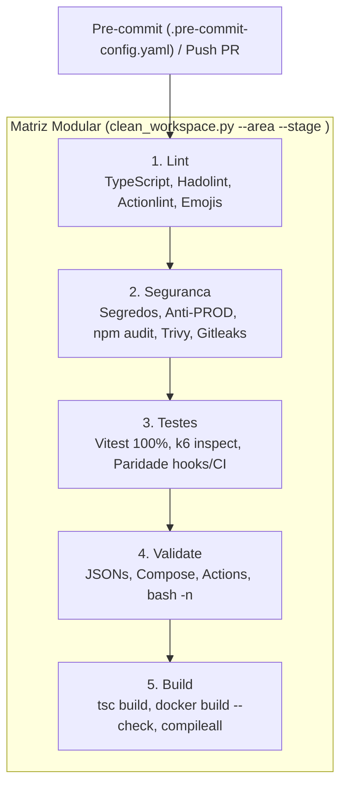

# DevOps, CI/CD e Automação Contínua

Especificação formal da esteira de qualidade local, git hooks e Integração Contínua (CI) do **Palmeiras K6 Test (HML)**.

## 1. Topologia da Esteira de Qualidade

A validação automatizada executada via [clean_workspace.py](../scripts/operations/clean_workspace.py) e no pipeline GitHub Actions ([ci.yml](../.github/workflows/ci.yml)) segue fluxo determinístico *fail-fast* em 5 estágios sequenciais por área tecnológica (`NOME_DA_TECNOLOGIA | NOME_DO_JOB_STEP`):



## 2. Matriz de Qualidade Unificada (4 Áreas x 5 Estágios)

| Área Temática | Lint | Segurança | Testes | Validação | Build |
| :--- | :--- | :--- | :--- | :--- | :--- |
| **TypeScript** | `tsc --noEmit`, ESLint strict, zero comentários em `src/`, `<= 300` linhas | Auditoria anti-PROD em `src/`, `npm audit --omit=dev` | Vitest `100%` branch coverage + `k6 inspect` nos 9 cenários | JSONs e integridade de links Markdown | Compilação `tsc -p tsconfig.build.json` (`dist/`) |
| **Docker** | `hadolint` em `infra/docker/Dockerfile` e zero emojis | Segredos, anti-PROD e `trivy config` | Inspeção do entrypoint (`smoke.ts`) | `Dockerfile`, `.dockerignore` e `docker compose config -q` | `docker build --check -f infra/docker/Dockerfile .` |
| **GitHub** | `actionlint .github/workflows/ci.yml` e zero emojis | Segredos, anti-PROD e `gitleaks dir .github` | Paridade `.pre-commit-config.yaml` x actions (`NOME_DA_TECNOLOGIA \| STEP`) | Presença das Composite Actions e `.agents/` | `linters/releaserc.json` e template de release |
| **Scripts** | Zero emojis e `shellcheck` (quando instalado) | Varredura de segredos em `scripts/` e `Makefile` | `--help`, `make -n` e `make hml-anti-prod` | `bash -n` nos scripts `.sh`/hooks e `commitlint.config.mjs` | `python3 -m compileall -q scripts/operations` |

## 3. Bidirecionalidade e Comandos de Validação Local

O fluxo local ([.pre-commit-config.yaml](../.pre-commit-config.yaml) e `Makefile`) aciona os mesmos módulos `scripts/operations/gates/` executados pelas Composite Actions do workflow `ci.yml`:

```bash
# Execução integral (Commitlint + 4 áreas x 5 estágios com resumo)
make app-ci          # ou make ci / make all / make app-gate STAGE=all

# Execução canônica por estágio (todas as áreas)
make app-gate STAGE=lint
make app-gate STAGE=security
make app-gate STAGE=test
make app-gate STAGE=validate
make app-gate STAGE=build

# Execução granular por área e estágio
python3 scripts/operations/clean_workspace.py --area typescript --stage test

# Execução canônica em HML (exclusivo HML)
make test-smoke TARGET=alb   # Validação funcional direta no ALB (recomendado)
make test-smoke TARGET=ec2   # Validação direta na EC2 via túnel SSM
make test-504 MODE=compare   # Comparativo 3-vias de timeout e sessão
make obs-recon               # Descoberta de recursos atuais de HML
make hml-anti-prod           # Valida fail-fast contra prod_alb
```

## 4. Governança de Commits e Git Hooks

- **Instalação de Hooks**: Execute `make app-pre-commit` (ou `make hooks`) para configurar `pre-commit` (`pre-commit` e `commit-msg`) ou `core.hooksPath` em `.githooks/` como fallback.
- **Execução Manual de Hooks**: Execute `make app-pre-commit-run`.
- **Conventional Commits**: Todas as mensagens seguem [commitlint.config.mjs](../linters/commitlint.config.mjs) (`feat`, `fix`, `docs`, `style`, `refactor`, `perf`, `test`, `build`, `ci`, `chore`, `revert`) e alimentam o `semantic-release` em pushes para `main`.

## Testar o ALB com a origem protegida

`make test-smoke TARGET=alb` usa uma EC2 saudável do `TESTE-WP` para abrir um túnel SSM até uma interface privada do ALB descoberto. A URL continua sendo `https://hmlverdao.palmeiras.com.br`; o mapeamento de conexão do k6 aponta para a porta local do túnel, preservando hostname, SNI e validação do certificado. O controlador encerra a sessão ao final, inclusive quando o k6 reprova thresholds.

```bash
make test-smoke TARGET=alb
make test-smoke TARGET=all
make docker-test TEST=smoke TARGET=alb
```

São necessários AWS CLI autenticado, Session Manager Plugin e permissões SSM para `AWS-StartPortForwardingSessionToRemoteHost`. A instância gerenciada precisa alcançar a porta 443 privada do ALB. O SG cliente `hml-k6-ssm-client` identifica somente os hosts de HML autorizados; o ALB permite HTTPS desse grupo pela rede privada. A entrada pública permanece restrita à lista Azion. O executor não cria regras temporárias, não libera o IP do operador e não modifica `/etc/hosts`.

O manifesto registra `connection_mode=ssm_private_alb`, `selected_instance` e `alb_private_ip`. O acesso direto público ao ALB continua bloqueado. A configuração de rede foi persistida no template do ASG, sem refresh. A comparação de latência deve considerar o transporte SSM; esse caminho atende diagnóstico funcional e não representa capacidade ou latência de tráfego público. A execução via Docker utiliza a rede host configurada no projeto Linux para alcançar o túnel local. Carga e estresse continuam exigindo autorização própria.
